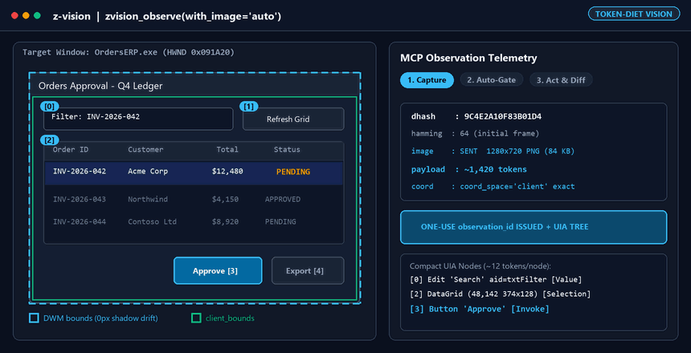
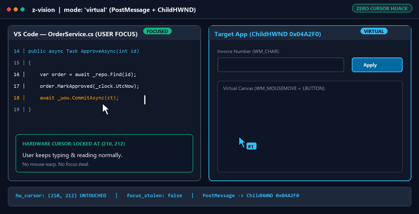
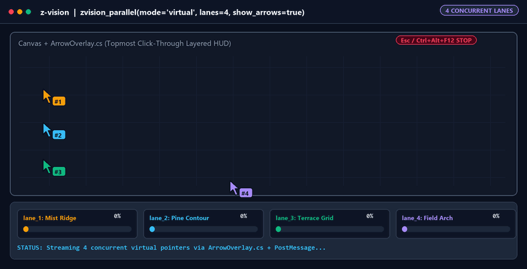

# z-vision — Token-Diet Windows Desktop Vision & Safe Agent Arm

[](https://github.com/kzxl/z-vision/releases)
[](LICENSE)
[](https://nodejs.org)
[](https://learn.microsoft.com/en-us/windows/win32/winauto/entry-uiauto-win32)
[](#zero-sdk-native-architecture)

> **Give AI coding agents crisp Windows desktop eyes, zero-hijack virtual pointers, and multi-arrow parallel execution without burning vision tokens.**  
> `z-vision` pairs a token-diet **Node.js 22+ MCP server** with an on-the-fly **C# 5 native Windows host** compiled by stock `.NET Framework 4.x` `csc.exe` — zero npm packages, zero .NET SDK required, and built-in **Esc / Ctrl+Alt+F12** emergency stop.

<p align="center">
  
</p>

---

## Visual Demos

### Virtual Mouse (`mode: "virtual"`) — Zero Hardware Cursor Hijack
Resolves leaf child windows (`ChildWindowFromPointEx` + `ScreenToClient`) and dispatches `WM_MOUSEMOVE` / `WM_LBUTTON*` / `WM_MOUSEWHEEL` / `WM_CHAR` directly to target `HWND`s while leaving the user's real cursor and focused editor undisturbed.

<p align="center">
  
</p>

### Multi-Arrow Parallel Execution (`zvision_parallel` + `ArrowOverlay.cs`)
Runs up to **8 concurrent stroke/input lanes** (`virtual` per-lane `PostMessage` or Win8+ multi-contact `InjectTouchInput`), rendered in real time through a topmost click-through layered arrow HUD (`#1`..`#N`) that clears immediately on completion or `Esc`.

<p align="center">
  
</p>

---

## Key Capabilities

### Desktop Vision ("Eyes")
- **Window Enumeration & Launch (`zvision_windows`)**: Lists visible windows with both `DWMWA_EXTENDED_FRAME_BOUNDS` (`bounds`, eliminating invisible Windows 10/11 drop-shadow drift) and `client_bounds` (`GetClientRect`). Optionally launches target apps first via `launch_exe` / `launch_args`.
- **Compact UI Automation Tree (`zvision_observe`)**: Walks `UIAutomationClient` controls with COM/disposal guards and returns 1-line summaries (`[0] Button "Save" aid=btnSave (420,310 80x28) [Invoke]`) — ~10–15 tokens/control.
- **64-Bit Perceptual dHash Gating (`with_image: "auto"`)**: Computes a 9x8 BT.709 grayscale difference hash on every frame. When the Hamming distance vs. the prior frame is `<= 2` and UIA nodes are present, redundant screenshots are suppressed automatically and `image_size` resets to `bounds` to eliminate phantom coordinate scaling.
- **Explicit Coordinate Spaces (`coord_space`)**: Supports `image` (default downscaled screenshot pixels), `window` (offset from DWM `bounds`), `client` (offset from `client_bounds` inside titlebar/borders), and `screen` (exact virtual-desktop pixels).
- **Native Windows WinRT OCR (`zvision_ocr`)**: Uses `Windows.Media.Ocr` directly from Windows 10/11 WinMetadata returning lines, words, and absolute screen bounding boxes (gracefully degrades if WinMetadata is absent).
- **Template Matching**: Coarse-to-fine Normalized Cross Correlation (NCC) over grayscale buffers for owner-drawn icons or custom surfaces.

### Precision Physical, Virtual & Parallel Arm ("Hands")
- **Physical Pixel-Center Actuation (`mode: "physical"`)**: `SendInput` across multi-monitor virtual desktops (`MOUSEEVENTF_VIRTUALDESK`) with pixel-center `65536` rounding, `GetCursorPos` verification, optional `restore_cursor`, full UTF-16 / Vietnamese typing (`KEYEVENTF_UNICODE`), STA clipboard-preserving `paste`, hotkey chords (`key`), and semantic UIA (`mode: "uia"` / `physical: false`).
- **Virtual Background Mouse (`mode: "virtual"`)**: Sends targeted `PostMessage` mouse, wheel, and character events directly to resolved leaf child `HWND`s without moving the hardware cursor or stealing active window focus.
- **Sequential Batch Plans (`zvision_plan`)**: Pre-validates and runs **1..50 sequential steps** in a single turn (`click`, `drag`, `type`, `paste`, `key`, `wait_settle`, `wait_text`, `sleep`), stopping immediately on first failure or emergency stop.
- **Concurrent Multi-Arrow Lanes (`zvision_parallel`)**: Runs **1..8 concurrent lanes** in `virtual` mode or Win8+ `touch` multi-pointer `InjectTouchInput` mode with numbered click-through overlay arrows (`show_arrows: true`).

#### Example: Virtual Client-Space Action & Parallel Multi-Arrow Batch
```json
// Single action targeting Paint / WinForms canvas without moving hardware cursor
{
  "observation_id": "obs_42",
  "action": "drag",
  "mode": "virtual",
  "coord_space": "client",
  "points": [[80, 120], [220, 95], [380, 140]],
  "restore_cursor": true,
  "reason": "Draw ridge stroke inside client canvas"
}
```
```json
// 4-lane concurrent parallel drawing with numbered ArrowOverlay HUD
{
  "observation_id": "obs_43",
  "mode": "virtual",
  "coord_space": "client",
  "show_arrows": true,
  "lanes": [
    { "id": "sky",     "steps": [{ "action": "drag", "points": [[40, 80], [520, 80]], "steps": 14 }] },
    { "id": "ridge",   "steps": [{ "action": "drag", "points": [[40, 150], [280, 130], [520, 145]], "steps": 16 }] },
    { "id": "terrace", "steps": [{ "action": "drag", "points": [[40, 220], [520, 220]], "steps": 14 }] },
    { "id": "arch",    "steps": [{ "action": "drag", "points": [[240, 260], [240, 195], [320, 195], [320, 260]], "steps": 16 }] }
  ],
  "reason": "Render 4 landscape layers concurrently"
}
```

### Safety & Control Fences
- **One-Use `observation_id` + Window Drift Guard**: Every `zvision_act`, `zvision_plan`, and `zvision_parallel` consumes its `observation_id` once and aborts (`stale_observation`) if the window moved/resized beyond `4px` or if Stop occurred.
- **Process Tier Isolation**:
  - `blocked`: UAC / credential dialogs (`consent.exe`, `CredentialUIBroker.exe`, `LogonUI.exe`, `LockApp.exe`) block all input.
  - `click-only`: Terminals and IDEs (`WindowsTerminal`, `pwsh`, `cmd`, `Code`, `devenv`, `rider64`, `regedit`, etc.) reject typing/keystrokes unless `allow_restricted: true` is explicitly passed.
- **Sensitive Action Confirmation**: Blocks English/Vietnamese destructive labels (`delete`, `pay`, `submit`, `password`, `xóa`, `thanh toán`, `chuyển khoản`, `đăng nhập`, ...) and dangerous hotkeys (`Alt+F4`, `Win+R`, `Ctrl+Alt+Del`) unless `confirm_sensitive: true` + `reason` are supplied.
- **Hardware Emergency Stop (`zvision_stop`)**: Dedicated low-level hook (`WH_KEYBOARD_LL`) intercepts physical **`Esc`** or **`Ctrl+Alt+F12`**, latches `emergency_stopped`, releases all held inputs tracked in `InputLedger`, and immediately clears `ArrowOverlay`.

---

## MCP Tools (8 Focused Tools)

| Tool | Purpose |
| :--- | :--- |
| `zvision_status` | Inspect monitors/DPI, virtual mouse & touch injection support, cursor position, WinRT OCR, and Stop state |
| `zvision_windows` | List visible desktop windows (`hwnd`, `pid`, `process`, `title`, `bounds`, `client_bounds`) or launch app via `launch_exe` |
| `zvision_observe` | Read compact UIA tree, 64-bit `dhash`, optional WinRT OCR, and dHash-gated screenshot; issues one-use `observation_id` |
| `zvision_act` | Execute one guarded action via `mode` (`physical`, `virtual`, `uia`) and `coord_space` (`image`, `window`, `client`, `screen`) |
| `zvision_plan` | Pre-validate and run 1..50 sequential steps (`wait_settle` / `wait_text` / actions) in one turn |
| `zvision_parallel` | Run 1..8 concurrent lanes (`virtual` or `touch`) with live numbered `ArrowOverlay` HUD |
| `zvision_ocr` | Run WinRT OCR on a window or screen ROI `[x, y, w, h]` returning screen coordinates |
| `zvision_stop` | Latch emergency stop, reset stop state, release all held inputs, and clear overlay arrows |

---

## Zero-SDK Native Architecture

1. On first run on Windows, `scripts/lib/native-builder.mjs` locates stock `C:\Windows\Microsoft.NET\Framework64\v4.0.30319\csc.exe`, GAC `UIAutomation*` / `WindowsBase` assemblies, and `C:\Windows\System32\WinMetadata\Windows.*.winmd`.
2. It compiles `scripts/native/*.cs` (`ZVisionHost.cs`, `UiaTree.cs`, `InputArm.cs`, `VirtualPointer.cs`, `ArrowOverlay.cs`, etc.) into `~/.z-plugin/z-vision/bin/ZVisionHost-<sha256>.exe` (override with `ZVISION_DATA_DIR`).
3. If `WinMetadata` is unavailable on a machine, it automatically falls back to compiling core UIA + Capture + dHash + InputArm + VirtualPointer + ArrowOverlay without WinRT OCR.
4. `scripts/lib/host-client.mjs` spawns `ZVisionHost.exe` lazily over UTF-8 newline-delimited JSON stdio and shuts it down after idle timeout.

---

## Installation

### Google Antigravity & ZCode
```powershell
git clone https://github.com/kzxl/z-vision.git
cd z-vision
powershell -ExecutionPolicy Bypass -File install.ps1
```

### Cursor / Claude Code / Any MCP Client
Add to your `.cursor/mcp.json` or `.claude_mcp.json`:
```json
{
  "mcpServers": {
    "z-vision": {
      "command": "node",
      "args": ["C:/path/to/z-vision/scripts/mcp-server.mjs"]
    }
  }
}
```

### Standalone CLI
```bash
npm run build
node scripts/cli.mjs status
node scripts/cli.mjs windows
node scripts/cli.mjs observe 0 --image
node scripts/cli.mjs ocr 0
node scripts/cli.mjs stop
```

---

## Testing

```bash
npm run check
npm test
```

Runs safety-policy unit tests (`coord_space`, `validateParallelLanes`), mock-transport vision-engine tests, MCP JSON-RPC stdio smoke tests, and on Windows compiles `ZVisionHost.exe` via `csc.exe` and executes real desktop probe `status`, `windows` (`client_bounds`), `observe`, virtual click (`CLICKED_VIRTUAL` without cursor hijack), 2-lane `parallel`, `ocr`, and `stop`/`reset` checks (**65 assertions**).

---

## License

MIT — see [LICENSE](LICENSE). Part of the [z-plugin](https://github.com/kzxl/z-plugin) ecosystem.
